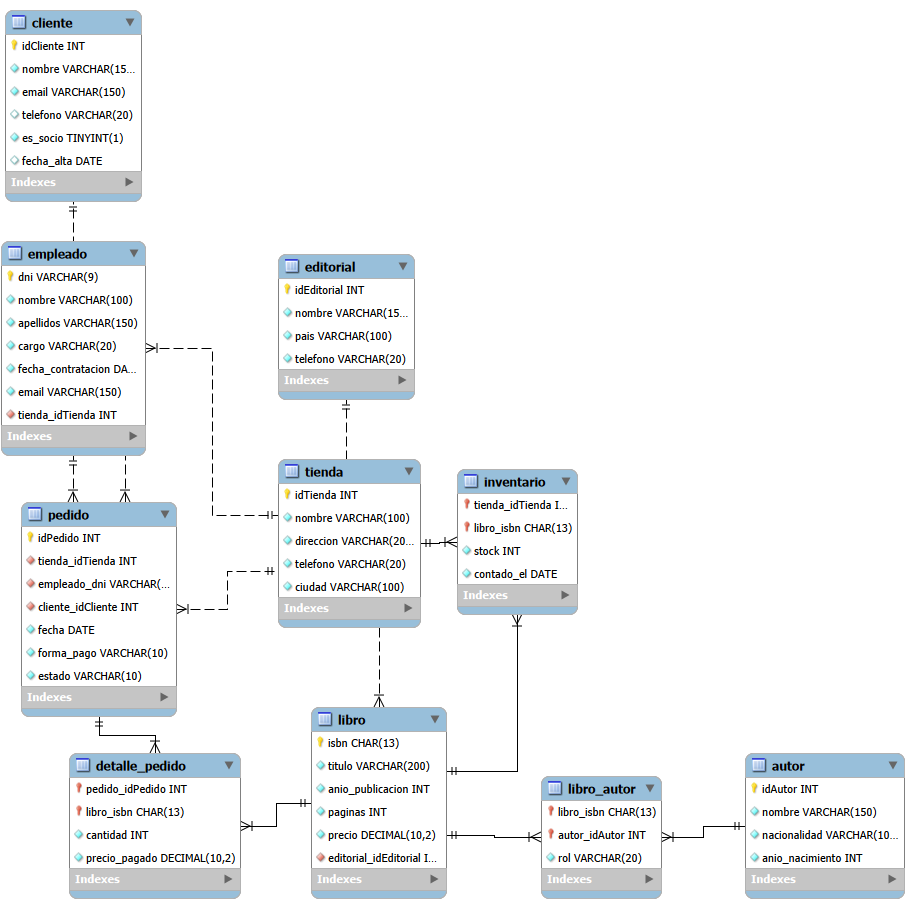

# Base de datos de Páginas de Villa Serena

## 1. Resumen del caso

Páginas de Villa Serena es una librería que tiene tres tiendas: Centro, Ribera y Universidad. Actualmente cada tienda lleva sus datos por separado y esto hace que sea difícil saber el stock real de cada libro.

La librería necesita una base de datos para guardar los libros, editoriales, autores, tiendas, empleados, clientes, inventario y pedidos. También tiene que guardar las líneas de cada pedido y el precio que se pagó en ese momento.

La base de datos tiene que permitir consultar el stock de cada tienda, las ventas, los pedidos de los clientes y los empleados que los han atendido. También tiene que permitir trabajar con libros que tengan más de un autor.

## 2. Análisis del caso

### 2.1 Entidades y atributos

| Entidad | Atributos encontrados | Fragmento del caso |
|---|---|---|
| Tienda | nombre, dirección, teléfono, ciudad | "Hoy tiene tres tiendas: Centro, Ribera y Universidad. Cada una tiene su nombre, su dirección, su teléfono y su ciudad" |
| Libro | ISBN, título, año de publicación, páginas, precio de catálogo | "Cada libro se identifica por..." |
| Editorial | nombre, país, teléfono | "de cada editorial anotan su nombre, el país y un teléfono de contacto para hacer pedidos." |
| Autor | nombre, nacionalidad, año de nacimiento | "De cada autor guardamos el nombre, la nacionalidad y el año de nacimiento." |
| Inventario | stock, fecha del último conteo | "Lo que quiero es que para cada libro y cada tienda sepa cuántas copias hay, y cuándo se contó por última vez." |
| Empleado | DNI, nombre, apellidos, cargo, fecha de contratación, correo | "En cada tienda trabajan varios empleados, y cada empleado trabaja en una sola tienda. De cada uno guardan el DNI, el nombre y los apellidos, el cargo (librero, cajero o encargado), la fecha de contratación y el correo de trabajo." |
| Cliente | nombre, correo, teléfono, socio, fecha de alta | " De cada socio guardan el nombre completo, el correo electrónico, el teléfono y la fecha de alta. Los clientes que compran sin ser socios se registran igualmente" |
| Pedido | número, tienda, empleado, cliente, fecha, forma de pago, estado | "Un pedido se hace siempre en una tienda, lo atiende un empleado y lo compra un cliente. Tiene una fecha, una forma de pago (efectivo, tarjeta o bizum) y un estado" |
| Detalle del pedido | libro, cantidad, precio cobrado | "Cada pedido puede llevar varios libros distintos, y de cada uno me interesa la cantidad." |
| Libro-Autor | libro, autor, papel del autor | "quiere distinguir si el autor es principal o colaborador en cada libro" |

Hemos separado `Libro-Autor` porque un libro puede tener varios autores y un autor puede aparecer en muchos libros.

También hemos separado `Inventario` porque el stock depende de la tienda. No es correcto poner un único campo `stock` en `Libro`.

### 2.2 Relaciones

| Relación | Cardinalidad | Cómo se resuelve | Razón |
|---|---|---|---|
| Editorial - Libro | 1:N | `libro.editorial_id` | Una editorial publica muchos libros y un libro tiene una editorial. |
| Libro - Autor | N:M | `libro_autor` | Un libro puede tener varios autores y un autor puede tener varios libros. |
| Tienda - Inventario | 1:N | `inventario.tienda_id` | Una tienda puede tener muchos libros en inventario. |
| Libro - Inventario | 1:N | `inventario.libro_isbn` | Un libro puede estar en varias tiendas. |
| Tienda - Empleado | 1:N | `empleado.tienda_id` | En una tienda trabajan varios empleados y cada empleado trabaja en una tienda. |
| Tienda - Pedido | 1:N | `pedido.tienda_id` | Un pedido se hace siempre en una tienda. |
| Empleado - Pedido | 1:N | `pedido.empleado_dni` | Un empleado puede atender varios pedidos. |
| Cliente - Pedido | 1:N | `pedido.cliente_id` | Un cliente puede hacer varios pedidos. |
| Pedido - Libro | N:M | `detalle_pedido` | Un pedido tiene varios libros y un libro puede aparecer en muchos pedidos. |

Las tablas intermedias son `libro_autor` y `detalle_pedido`.

`libro_autor` tiene el atributo `rol`, porque el caso dice que hay que distinguir entre autor principal y colaborador.

`detalle_pedido` tiene `cantidad` y `precio_pagado`, porque son datos propios de cada línea del pedido.

### 2.3 Datos descartados

| Dato | Motivo |
|---|---|
| Total del ticket | Se puede calcular sumando cantidad por precio pagado de las líneas. |
| Stock dentro de `libro` | El stock cambia según la tienda, por eso va en `inventario`. |
| Nombre de la editorial repetido en cada libro | Se guarda una sola vez en `editorial` y se relaciona con `libro`. |
| Autores separados por `/` en un solo campo | Se sustituye por la relación `libro_autor`. |
| Historial de cambios de tienda de un empleado | El caso dice que no es necesario guardar el historial. |
| Precio antiguo dentro de `libro` para pedidos anteriores | Para los pedidos se guarda el precio realmente pagado en `detalle_pedido`. |
| Total de facturación de una tienda | Se puede calcular a partir de los pedidos entregados. |

## 3. Reglas de negocio

1. Una tienda tiene un nombre, dirección, teléfono y ciudad.
2. Cada libro se identifica por un ISBN de 13 cifras.
3. Cada libro pertenece a una única editorial.
4. Una editorial puede publicar muchos libros.
5. Un libro puede tener uno o varios autores.
6. Un autor puede escribir varios libros.
7. En cada relación entre libro y autor se indica si el autor es principal o colaborador.
8. El stock se controla por tienda y por libro.
9. Si un libro no está en una tienda, no hace falta crear una fila de inventario para esa tienda.
10. Cada empleado trabaja en una única tienda.
11. Un empleado puede ser librero, cajero o encargado.
12. Si un empleado cambia de tienda, solo se guarda su nueva tienda y no el historial.
13. El correo electrónico de un cliente es único.
14. Un cliente puede ser socio o no serlo.
15. Los clientes que no son socios también se registran.
16. Un pedido se realiza siempre en una tienda.
17. Un pedido es atendido por un empleado.
18. El empleado que atiende un pedido debe pertenecer a la tienda donde se realiza el pedido.
19. Un pedido pertenece a un cliente.
20. Un pedido puede tener varios libros distintos.
21. La cantidad de cada libro de un pedido debe ser mayor que cero.
22. Cada pedido tiene una forma de pago: efectivo, tarjeta o bizum.
23. Cada pedido tiene un estado: preparado, entregado o cancelado.
24. El precio guardado en una línea del pedido es el precio que realmente se cobró.
25. El precio pagado no puede ser negativo.
26. El stock de un libro no puede ser negativo.

## 4. Diagrama entidad-relación

El diagrama representa las tablas principales y las relaciones del diseño.



### Tabla de relaciones

| Relación | Tipo | Cómo se resuelve |
|---|---|---|
| editorial - libro | 1:N | `libro.editorial_id` |
| libro - autor | N:M | `libro_autor` |
| tienda - inventario | 1:N | `inventario.tienda_id` |
| libro - inventario | 1:N | `inventario.libro_isbn` |
| tienda - empleado | 1:N | `empleado.tienda_id` |
| tienda - pedido | 1:N | `pedido.tienda_id` |
| empleado - pedido | 1:N | `pedido.empleado_dni` |
| cliente - pedido | 1:N | `pedido.cliente_id` |
| pedido - libro | N:M | `detalle_pedido` |

## 5. Modelo lógico
PK - Primary Key

FK - Foreign Key

### `tienda`

| Columna | Clave | Referencia |
|---|---|---|
| `id` | PK | |
| `nombre` | | |
| `direccion` | | |
| `telefono` | | |
| `ciudad` | | |

### `editorial`

| Columna | Clave | Referencia |
|---|---|---|
| `id` | PK | |
| `nombre` | | |
| `pais` | | |
| `telefono` | | |

### `libro`

| Columna | Clave | Referencia |
|---|---|---|
| `isbn` | PK | |
| `titulo` | | |
| `anio_publicacion` | | |
| `paginas` | | |
| `precio` | | |
| `editorial_id` | FK | `editorial.idEditorial` |

### `autor`

| Columna | Clave | Referencia |
|---|---|---|
| `id` | PK | |
| `nombre` | | |
| `nacionalidad` | | |
| `anio_nacimiento` | | |

### `libro_autor`

| Columna | Clave | Referencia |
|---|---|---|
| `libro_isbn` | PK, FK | `libro.isbn` |
| `autor_id` | PK, FK | `autor.idAutor` |
| `rol` | | |

### `empleado`

| Columna | Clave | Referencia |
|---|---|---|
| `dni` | PK | |
| `nombre` | | |
| `apellidos` | | |
| `cargo` | | |
| `fecha_contratacion` | | |
| `email` | UNIQUE | |
| `tienda_id` | FK | `tienda.idTienda` |

### `cliente`

| Columna | Clave | Referencia |
|---|---|---|
| `id` | PK | |
| `nombre` | | |
| `email` | UNIQUE | |
| `telefono` | | |
| `es_socio` | | |
| `fecha_alta` | | |

### `inventario`

| Columna | Clave | Referencia |
|---|---|---|
| `tienda_id` | PK, FK | `tienda.idTienda` |
| `libro_isbn` | PK, FK | `libro.isbn` |
| `stock` | | |
| `contado_el` | | |

### `pedido`

| Columna | Clave | Referencia |
|---|---|---|
| `id` | PK | |
| `tienda_id` | FK | `tienda.idTienda` |
| `empleado_dni` | FK | `empleado.dni` |
| `cliente_id` | FK | `cliente.idCliente` |
| `fecha` | | |
| `forma_pago` | | |
| `estado` | | |

### `detalle_pedido`

| Columna | Clave | Referencia |
|---|---|---|
| `pedido_id` | PK, FK | `pedido.idPedido` |
| `libro_isbn` | PK, FK | `libro.isbn` |
| `cantidad` | | |
| `precio_pagado` | | |

## 6. Script SQL (schema.sql)

El script se encuentra en `schema.sql`.

Crea la base de datos `libreria` y las diez tablas del modelo. Primero se crean las tablas que no dependen de otras y después las que tienen claves foráneas.

Se han relacionado y hecho los "checks" necesarios para cumplir lo expuesto en el apartado 3.

## 7. Diccionario de datos

### `tienda`

| Columna | Tipo | Obligatorio | Descripción |
|---|---|---|---|
| `id` | INT | Sí | Identificador de la tienda. |
| `nombre` | VARCHAR(100) | Sí | Nombre con el que se identifica la tienda. |
| `direccion` | VARCHAR(200) | Sí | Dirección de la tienda. |
| `telefono` | VARCHAR(20) | Sí | Teléfono de contacto. |
| `ciudad` | VARCHAR(100) | Sí | Ciudad donde está la tienda. |

### `editorial`

| Columna | Tipo | Obligatorio | Descripción |
|---|---|---|---|
| `id` | INT | Sí | Identificador de la editorial. |
| `nombre` | VARCHAR(150) | Sí | Nombre de la editorial. |
| `pais` | VARCHAR(100) | Sí | País de la editorial. |
| `telefono` | VARCHAR(20) | Sí | Teléfono para realizar pedidos. |

### `libro`

| Columna | Tipo | Obligatorio | Descripción |
|---|---|---|---|
| `isbn` | CHAR(13) | Sí | ISBN de 13 cifras que identifica el libro. |
| `titulo` | VARCHAR(200) | Sí | Título del libro. |
| `anio_publicacion` | INT | Sí | Año en el que se publicó. |
| `paginas` | INT | Sí | Número de páginas del libro. |
| `precio` | DECIMAL(10,2) | Sí | Precio de catálogo actual del libro. |
| `editorial_id` | INT | Sí | Editorial que publica el libro. |

### `autor`

| Columna | Tipo | Obligatorio | Descripción |
|---|---|---|---|
| `id` | INT | Sí | Identificador del autor. |
| `nombre` | VARCHAR(150) | Sí | Nombre completo del autor. |
| `nacionalidad` | VARCHAR(100) | Sí | Nacionalidad del autor. |
| `anio_nacimiento` | INT | Sí | Año de nacimiento. |

### `libro_autor`

| Columna | Tipo | Obligatorio | Descripción |
|---|---|---|---|
| `libro_isbn` | CHAR(13) | Sí | Libro relacionado. |
| `autor_id` | INT | Sí | Autor relacionado. |
| `rol` | VARCHAR(20) | Sí | Indica si es autor principal o colaborador. |

### `empleado`

| Columna | Tipo | Obligatorio | Descripción |
|---|---|---|---|
| `dni` | VARCHAR(9) | Sí | DNI que identifica al empleado. |
| `nombre` | VARCHAR(100) | Sí | Nombre del empleado. |
| `apellidos` | VARCHAR(150) | Sí | Apellidos del empleado. |
| `cargo` | VARCHAR(20) | Sí | Puede ser librero, cajero o encargado. |
| `fecha_contratacion` | DATE | Sí | Fecha en la que empezó a trabajar. |
| `email` | VARCHAR(150) | Sí | Correo de trabajo. No se repite. |
| `tienda_id` | INT | Sí | Tienda en la que trabaja actualmente. |

### `cliente`

| Columna | Tipo | Obligatorio | Descripción |
|---|---|---|---|
| `id` | INT | Sí | Identificador del cliente. |
| `nombre` | VARCHAR(150) | Sí | Nombre completo del cliente. |
| `email` | VARCHAR(150) | Sí | Correo para poder enviar avisos. No se repite. |
| `telefono` | VARCHAR(20) | No | Teléfono del cliente. |
| `es_socio` | BOOLEAN | Sí | Indica si el cliente es socio. |
| `fecha_alta` | DATE | No | Fecha de alta como socio. |

### `inventario`

| Columna | Tipo | Obligatorio | Descripción |
|---|---|---|---|
| `tienda_id` | INT | Sí | Tienda donde está el libro. |
| `libro_isbn` | CHAR(13) | Sí | Libro del inventario. |
| `stock` | INT | Sí | Número de copias disponibles. No puede ser negativo. |
| `contado_el` | DATE | Sí | Fecha del último recuento del stock. |

### `pedido`

| Columna | Tipo | Obligatorio | Descripción |
|---|---|---|---|
| `id` | INT | Sí | Número del pedido. |
| `tienda_id` | INT | Sí | Tienda donde se hace el pedido. |
| `empleado_dni` | VARCHAR(9) | Sí | Empleado que atiende el pedido. |
| `cliente_id` | INT | Sí | Cliente que realiza el pedido. |
| `fecha` | DATE | Sí | Fecha del pedido. |
| `forma_pago` | VARCHAR(10) | Sí | Efectivo, tarjeta o bizum. |
| `estado` | VARCHAR(10) | Sí | Preparado, entregado o cancelado. |

### `detalle_pedido`

| Columna | Tipo | Obligatorio | Descripción |
|---|---|---|---|
| `pedido_id` | INT | Sí | Pedido al que pertenece la línea. |
| `libro_isbn` | CHAR(13) | Sí | Libro comprado. |
| `cantidad` | INT | Sí | Número de copias compradas. |
| `precio_pagado` | DECIMAL(10,2) | Sí | Precio que realmente se pagó por cada copia en ese pedido. |

## 8. Decisiones de diseño

### Decisión 1: separar el inventario de los libros

Se ha decidido crear la tabla `inventario` en vez de poner `stock` dentro de `libro`.

La razón es que el mismo libro puede estar en varias tiendas y tener un stock diferente en cada una.

Alternativa descartada:poner un único `stock` en `libro`, pero entonces no se podría saber el stock de cada tienda.

### Decisión 2: crear `libro_autor`

Se ha creado una tabla intermedia para relacionar libros y autores.

La razón es que un libro puede tener varios autores y un autor puede tener muchos libros. Además, se necesita guardar si el autor es principal o colaborador.

Alternativa descartada: guardar todos los autores en un solo campo, lo que haria imposible distiguir el rol del autor.

### Decisión 3: guardar el precio pagado en el pedido

En `detalle_pedido` se guarda `precio_pagado`.

La razón es que el precio de catálogo puede cambiar. Si se consultara el precio actual del libro para un pedido antiguo, el ticket podría mostrar un precio diferente al que se pagó.

Alternativa descartada: usar solamente `libro.precio` para calcular los pedidos antiguos.

### Decisión 4: no guardar el total del pedido

No se guarda una columna `total` en `pedido`.

La razón es que se puede calcular sumando `cantidad * precio_pagado` de todas las líneas del pedido.

Alternativa descartada: guardar el total y tener que mantener dos datos que solo aportan redundancia.

### Decisión 5: no guardar el historial de tiendas de los empleados

Solo se guarda la tienda actual del empleado, como se nos ha indicado previamente.

## 9. Datos de prueba

Se han creado datos para comprobar las relaciones y las consultas.

Hay:

- 3 tiendas.
- 3 editoriales.
- 5 libros.
- 3 autores.
- 1 libro con dos autores.
- 5 empleados.
- 3 clientes.
- Inventario de varias tiendas.
- 5 pedidos.
- Varias líneas en cada pedido.

Los datos de prueba están en `schema.sql`.


## 10. Consultas de prueba

### 1. ¿Qué libros tiene la tienda Centro y cuántas copias quedan?
```sql
SELECT
    ti.nombre,
    li.titulo,
    inv.stock
FROM tienda ti
JOIN inventario inv
    ON ti.idTienda = inv.tienda_idTienda
JOIN libro li
    ON li.isbn = inv.libro_isbn
WHERE ti.nombre = 'centro';
```
#### Resultado:
|nombre|titulo|stock
|---|---|---|
|Centro|Libro1|5
|Centro|Libro2|0
|Centro|Libro3|3
|Centro|Libro4|2
|Centro|Libro5|4

### 2. ¿Cuánto ha facturado cada tienda este año?
```sql
SELECT
    t.nombre AS tienda,
    SUM(dp.cantidad * dp.precio_pagado) AS facturacion
FROM tienda t
JOIN pedido p
    ON t.idTienda = p.tienda_idTienda
JOIN detalle_pedido dp
    ON p.idPedido = dp.pedido_idPedido
WHERE p.estado = 'entregado'
  AND YEAR(p.fecha) = YEAR(CURDATE())
GROUP BY t.idTienda, t.nombre
ORDER BY facturacion DESC;
```
#### Resultado:
|tienda|facturacion
|---|---|
|Centro|100.40
|Universidad|73.50
|Ribera|61.50
### 3. ¿Qué clientes han hecho más de dos pedidos?
```sql
SELECT
    c.idCliente,
    c.nombre,
    COUNT(p.idPedido) AS total_pedidos
FROM cliente c
JOIN pedido p
    ON c.idCliente = p.cliente_idCliente
GROUP BY c.idCliente, c.nombre
HAVING COUNT(p.idPedido) > 2
ORDER BY total_pedidos DESC;
```
#### Resultado:

No hay resultado (para pedidos >=2, hay 2 resultados).

### 4. ¿Qué libros están agotados en una tienda pero disponibles en otra?
```sql
SELECT DISTINCT
    l.isbn,
    l.titulo
FROM libro l
JOIN inventario i1
    ON l.isbn = i1.libro_isbn
JOIN inventario i2
    ON l.isbn = i2.libro_isbn
WHERE i1.stock = 0
  AND i2.stock > 0
  AND i1.tienda_idTienda <> i2.tienda_idTienda;
```
#### Resultado:
|isbn|libro|
|---|---|
|9788400000002|Libro2|
|9788400000003|Libro3|
|9788400000001|Libro1|
|9788400000004|Libro4|
### 5. ¿Qué autores tienen libros en más de una editorial?
```sql
SELECT
    a.idAutor,
    a.nombre,
    COUNT(DISTINCT l.editorial_idEditorial) AS total_editoriales
FROM autor a
JOIN libro_autor la
    ON a.idAutor = la.autor_idAutor
JOIN libro l
    ON la.libro_isbn = l.isbn
GROUP BY a.idAutor, a.nombre
HAVING COUNT(DISTINCT l.editorial_idEditorial) > 1;
```
#### Resultado:
|idAutor|nombre|total_editoriales
|---|---|---|
|1|Autor1|2|
|2|Autor2|2|
## 11. Limitaciones y mejoras futuras

- No se guarda el historial de cambios de precio de los libros.
- No se guarda el historial de cambios de tienda de los empleados.
- No se guarda el porcentaje de descuento de los socios porque el caso no indica cuál es.
- No se guarda información de devoluciones de pedidos.
- No se controla automáticamente que el stock se reduzca al realizar un pedido. Esto se podría hacer después desde la aplicación.
- No se guarda un sistema de usuarios y contraseñas para los empleados.

Como mejora futura se podrían añadir estas funciones si la librería necesitara un sistema más completo.
